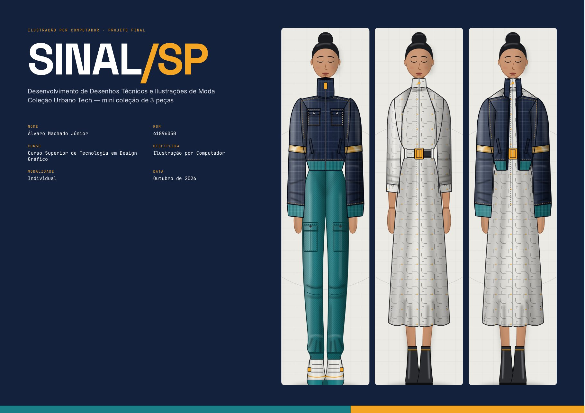
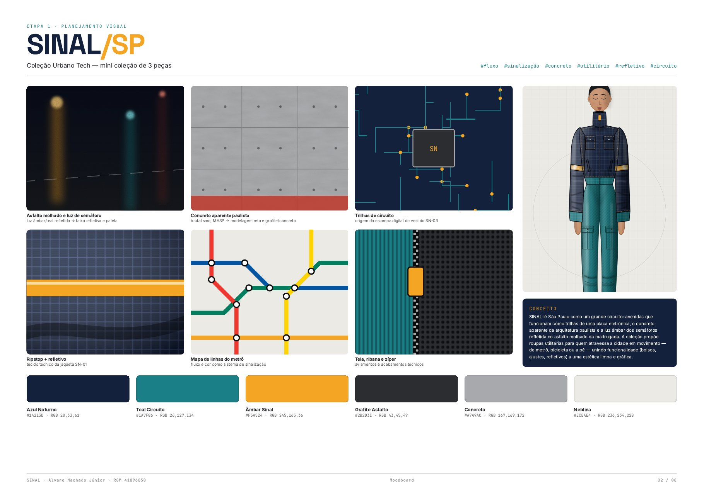
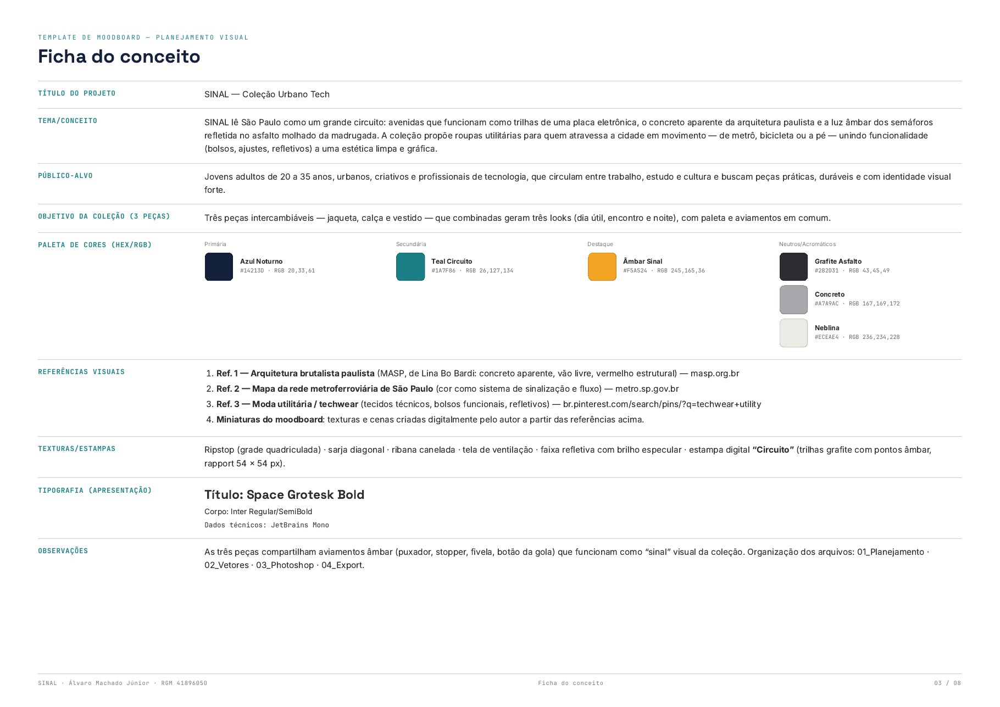
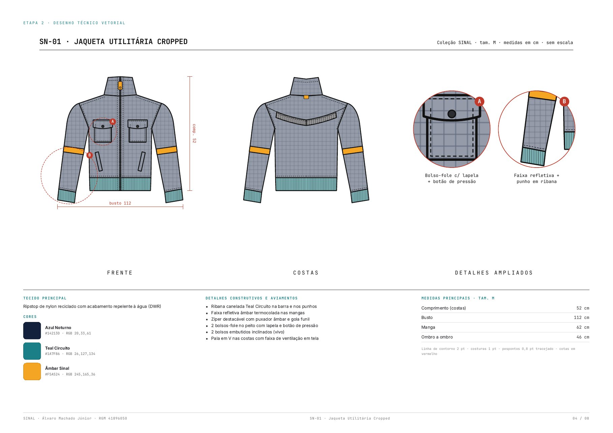
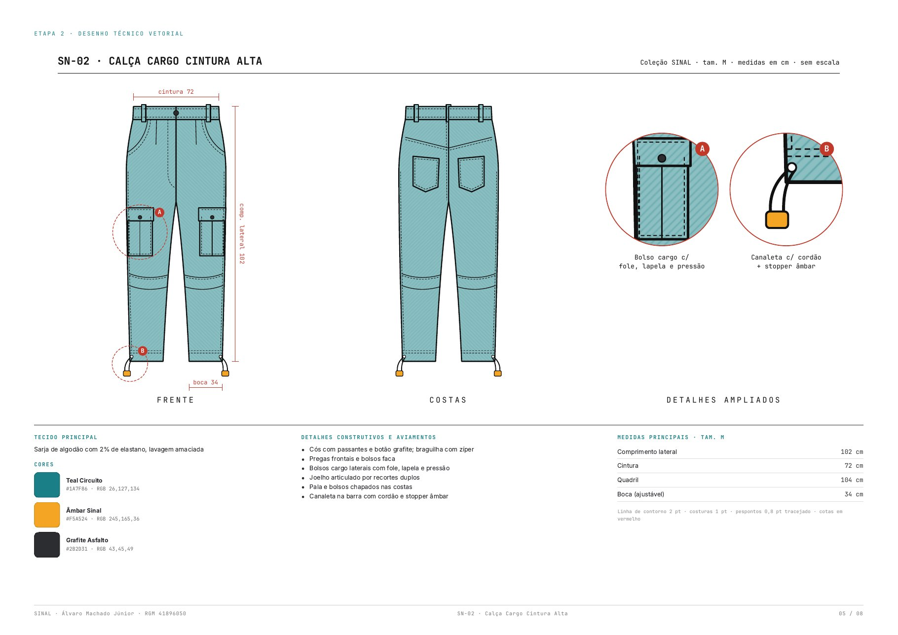
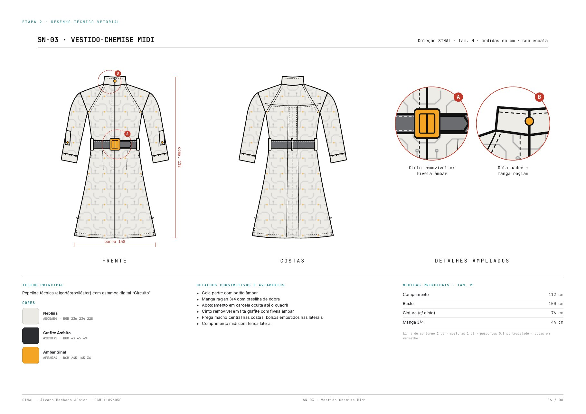
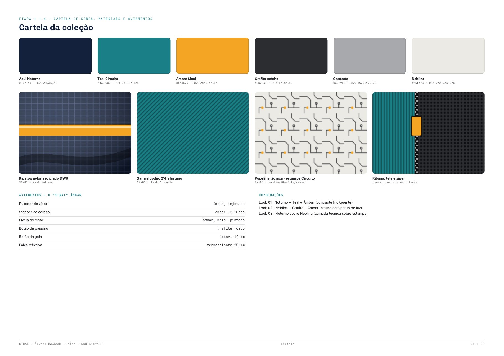
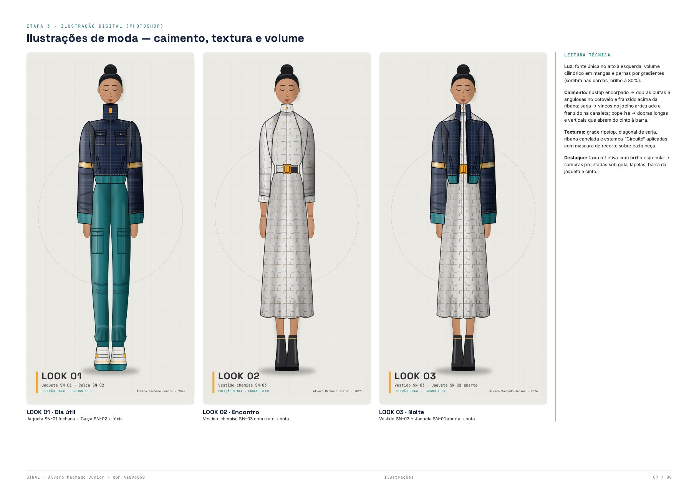

# SINAL/SP · Coleção Urbano Tech

**Desenhos técnicos e ilustrações de moda digitais.** Mini coleção de 3 peças: jaqueta, calça e vestido.

Trabalho final da disciplina **Ilustração por Computador**, do **Curso Superior de Tecnologia em Design Gráfico (UNICID)**, outubro de 2026.
Autor: **Álvaro Machado Júnior**, trabalho individual.

## Conceito

SINAL lê São Paulo como um grande circuito. As avenidas viram trilhas de uma placa eletrônica, e a coleção usa o concreto aparente da arquitetura paulista e a luz âmbar dos semáforos refletida no asfalto molhado da madrugada.

São roupas utilitárias para quem atravessa a cidade em movimento, de metrô, de bicicleta ou a pé. Elas unem funcionalidade (bolsos, ajustes e refletivos) a uma estética limpa e gráfica.

- **Público-alvo:** jovens adultos de 20 a 35 anos, urbanos e criativos, incluindo profissionais de tecnologia.
- **Intenção estética:** utilitarismo urbano com contraste entre azul noturno e teal, e um único ponto quente âmbar. Esse âmbar é o "sinal" e aparece em todos os aviamentos.

## Paleta

| Cor | Hex |
|---|---|
| Azul Noturno | `#14213D` |
| Teal Circuito | `#1A7F86` |
| Âmbar Sinal | `#F5A524` |
| Grafite Asfalto | `#2B2D31` |
| Concreto | `#A7A9AC` |
| Neblina | `#ECEAE4` |

## Pranchas

| | |
|---|---|
|  |  |
|  |  |
|  |  |

### Ilustrações de moda: caimento, textura e volume

## Peças

| Ref. | Peça | Tecido principal |
|---|---|---|
| SN-01 | Jaqueta utilitária cropped | Ripstop de nylon reciclado |
| SN-02 | Calça cargo cintura alta | Sarja de algodão com 2% de elastano |
| SN-03 | Vestido-chemise midi | Popeline com estampa digital "Circuito" |

## Processo

1. Pesquisa e moodboard, com a paleta definida em Hex/RGB.
2. Definição das 3 peças e dos 3 looks (Dia útil, Encontro e Noite).
3. Desenhos técnicos vetoriais com frente, costas e detalhes ampliados. Cada peça foi desenhada pela metade e espelhada, com camadas nomeadas e hierarquia de traço (contorno 2 pt, costuras 1 pt, pespontos 0,8 pt).
4. Croqui de 9 cabeças e ilustração digital em camadas no Photoshop.
5. Cores, texturas (ripstop, sarja, ribana e estampa "Circuito"), luz e sombra, com uma única fonte de luz.
6. Montagem das pranchas A3 e exportação em PDF.

**Softwares:** Adobe Illustrator / CorelDRAW (vetor) e Adobe Photoshop (ilustração).

## Arquivos

| Pasta | Conteúdo |
|---|---|
| [`pranchas/`](pranchas/) | Pranchas finais A3 em PDF |
| [`desenhos-tecnicos/`](desenhos-tecnicos/) | Desenhos técnicos em PDF e SVG (SN-01, SN-02, SN-03) |
| [`ilustracoes/`](ilustracoes/) | Ilustrações dos looks 01, 02 e 03 (JPEG 1400 × 2800 px, sRGB) |
| [`moodboard-e-memorial/`](moodboard-e-memorial/) | Moodboard/conceito e memorial técnico |
| [`imagens/`](imagens/) | Versão web das pranchas, usada neste README |

Os arquivos .psd em camadas não foram incluídos aqui por causa do tamanho.

## Autor

**Prof. Álvaro Machado Júnior**: [alvaromjunior.com/projetos](https://alvaromjunior.com/projetos) · [LinkedIn](https://www.linkedin.com/in/alvaro-machado-junior)

© 2026 Álvaro Machado Júnior. Todos os direitos reservados.
